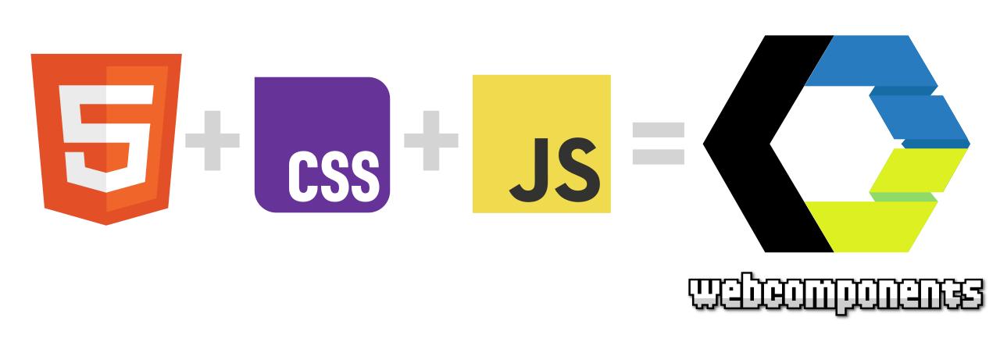
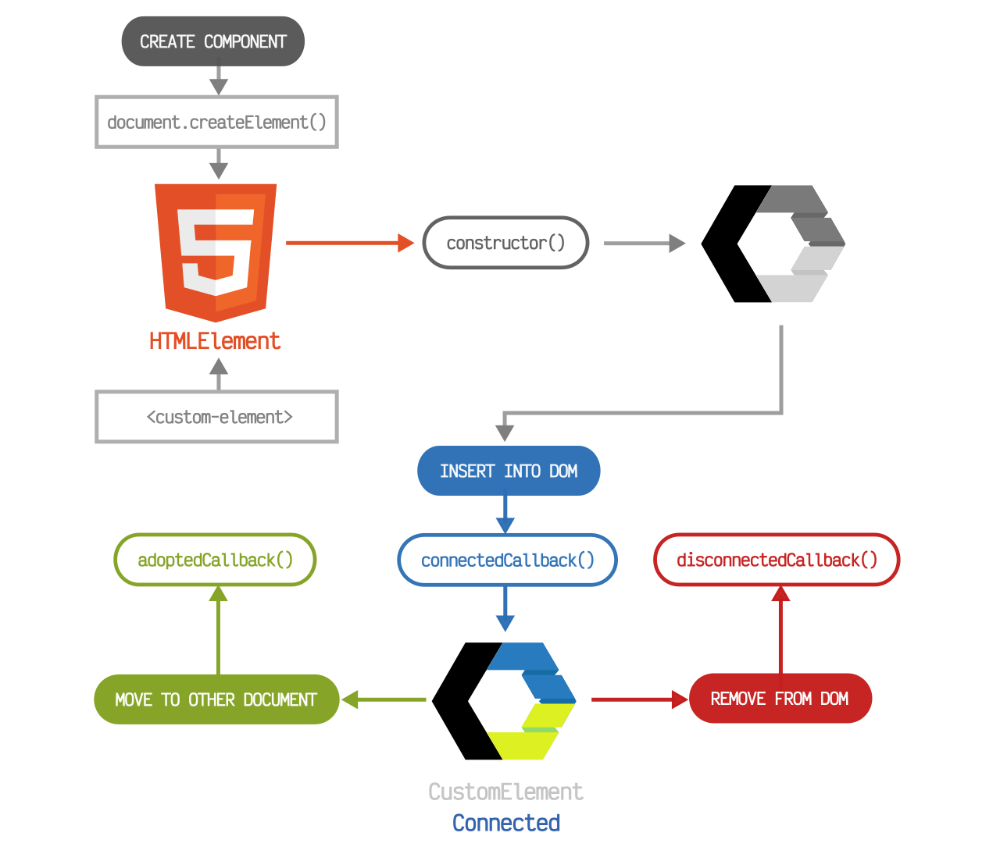
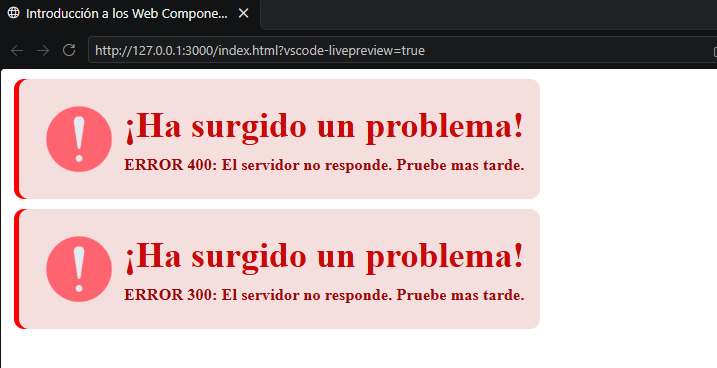

# Web-Components
Práctica 2 de Tecnologías Web: Cliente 

## Ejercicio 1
**Crear una página con un Web Component simple que permita verificar el ciclo de vida de una web component a través de la consola. En cada estado del web component mostrará un mensaje en consola cuando se active la función de callback pertinente: Creado, Adjuntado al DOM, Separado del DOM, cambio en los atributos.**

### Web Components
Los web components son un conjunto de estándares de la plataforma web que permiten crear etiquetas HTML personalizadas, reutilizables y con su funcionalidad y estilos encapsulados, sin depender de librerías o frameworks externos.

### Ciclo de vida de Web Components

Los WebComponent pasan por una serie de fases que se conocen como el ciclo de vida del WebComponent. 

Conociendo este ciclo y las fases que lo componen, es mucho más fácil predecir el funcionamiento de los WebComponents y trabajar con ellos.

Los métodos del ciclo de vida de un WebComponent que podemos escribir en una clase, serían los siguietes:

| Característica               | ¿Cuándo se ejecuta?                                                                                                                                     |
| ---------------------------- | ------------------------------------------------------------------------------------------------------------------------------------------------------- |
| `constructor()`              | Cuando se crea el custom element, y previamente ha sido definido en el registro.                                                                        |
| `connectedCallback()`        | Cuando el custom element se ha insertado en el documento HTML (DOM).                                                                                    |
| `disconnectedCallback()`     | Cuando el custom element se ha eliminado del documento HTML (DOM).                                                                                      |
| `adoptedCallback()`          | Cuando el custom element se ha movido a un nuevo documento (ej.: `iframes`).                                                                            |
| `attributeChangedCallback()` | Cuando se ha modificado un atributo observado del componente. [Ver atributos](https://lenguajejs.com/webcomponents/componentes/atributos-webcomponent/) |

### Aplicación del ciclo de vida en un Web Component

En nuestro caso, hemos creado un componente propio llamado `Error` para mostrar notificaciones de errores en la aplicación. Para desarrollarlo, hemos utilizado los distintos ciclos de vida de los Web Components, que nos permiten controlar qué ocurre en cada momento con el componente.

En el `constructor()`, inicializamos el componente y creamos su Shadow DOM, donde se encapsula su contenido.

Con `connectedCallback()`, detectamos cuándo se añade el componente al DOM y llamamos a `render()` para mostrar la notificación.

Por otro lado, `disconnectedCallback()` nos permite saber cuándo se elimina el componente del DOM, por si necesitamos realizar alguna tarea de limpieza.

Por último, utilizamos `attributeChangedCallback()` para detectar cambios en el atributo `error-id` y actualizar la notificación cuando sea necesario. Para ello, indicamos en `observedAttributes` que queremos observar dicho atributo.

Aclara cómo funciona \`Error\`Explica mejor \`observedAttributes\`

### Resultado del ejercicio

Finalmente, como resultado tenemos la siguiente página web que incorpora el Web Component insertado.

